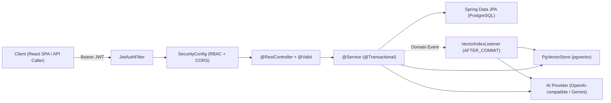
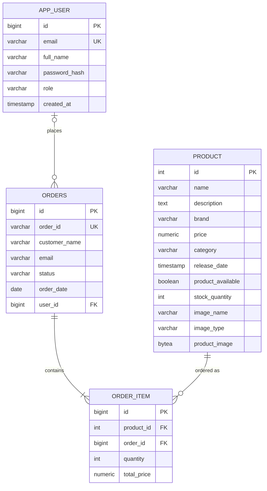

# Backend Design & Architecture (`SpringEcomAI`)

## 1. Overview & Tech Stack

The backend is a **Spring Boot 3.5.3** REST API written in **Java 21**, providing e-commerce catalog management, concurrency-safe order processing, stateless JWT authentication, and AI-powered semantic search, customer support RAG chatbot, and product draft/image generation.

| Layer | Technology |
|---|---|
| Runtime & Build | Java 21, Maven (`mvnw` / `pom.xml`) |
| Web & Validation | Spring Web, Spring Boot Validation (`jakarta.validation`), `springdoc-openapi-starter-webmvc-ui` 2.8.9 |
| Persistence | Spring Data JPA (Hibernate), PostgreSQL 16 (`postgresql` driver) |
| Security | Spring Security (stateless), JJWT `0.12.6` (HS256), BCrypt |
| AI & Vector Store | Spring AI `1.0.0` (`spring-ai-starter-model-openai`, `spring-ai-starter-vector-store-pgvector`, `spring-ai-advisors-vector-store`) |
| Testing | JUnit 5, Mockito, Spring Security Test (`MockMvc`), Testcontainers (`postgresql`) |
| Containerization | Multi-stage `Dockerfile` (Maven + Temurin 21 JRE, non-root `appuser`) |

---

## 2. Folder & File Inventory

```text
SpringEcomAI/
├── Dockerfile                          # Multi-stage build -> non-root Temurin 21 JRE image
├── docker-compose.yml                  # Standalone dev compose file
├── pom.xml                             # Maven dependencies & Spring AI BOM (1.0.0)
├── mvnw / mvnw.cmd                     # Maven Wrapper
└── src/
    ├── main/
    │   ├── java/com/lumora/shop/
    │   │   ├── SpringEcomAiApplication.java        # @SpringBootApplication entry point
    │   │   ├── config/
    │   │   │   ├── AdminSeeder.java                # Seeds initial ADMIN from ADMIN_EMAIL / ADMIN_PASSWORD
    │   │   │   ├── ChatClientConfig.java           # Exposes Spring AI ChatClient bean
    │   │   │   ├── OpenApiConfig.java              # Swagger UI (/swagger-ui.html) + Bearer JWT scheme
    │   │   │   └── VectorStoreConfig.java          # PgVectorStore (1536 dims, COSINE_DISTANCE, HNSW)
    │   │   ├── controller/
    │   │   │   ├── AdminController.java            # POST /api/admin/reindex
    │   │   │   ├── AuthController.java             # POST /api/auth/register, /api/auth/login
    │   │   │   ├── ChatBotController.java          # GET /api/chat/ask
    │   │   │   ├── HelloController.java            # GET /hello health/greeting endpoint
    │   │   │   ├── OrderController.java            # Order placement, listing, cancellation, status update
    │   │   │   └── ProductController.java          # Product CRUD, image serving, smart search, AI generation
    │   │   ├── exception/
    │   │   │   ├── EmailAlreadyUsedException.java  # 409 Conflict on duplicate registration
    │   │   │   ├── GlobalExceptionHandler.java     # @RestControllerAdvice -> uniform JSON error payloads
    │   │   │   ├── InsufficientStockException.java # 409 Conflict when stock < requested quantity
    │   │   │   ├── InvalidOrderStateException.java # 409 Conflict on illegal OrderStatus transitions
    │   │   │   └── ResourceNotFoundException.java  # 404 Not Found
    │   │   ├── model/
    │   │   │   ├── AppUser.java                    # Entity (app_user): email, fullName, passwordHash, role
    │   │   │   ├── Order.java                      # Entity (orders): orderId, status, items, user
    │   │   │   ├── OrderItem.java                  # Entity (order_item): product, quantity, totalPrice, order
    │   │   │   ├── OrderStatus.java                # Enum + state machine (canTransitionTo, isCancellable)
    │   │   │   ├── Product.java                    # Entity (product): metadata, stock, @Lob productImage
    │   │   │   ├── Role.java                       # Enum: USER, ADMIN
    │   │   │   └── dto/                            # Java records for requests & responses
    │   │   │       ├── AuthResponse.java
    │   │   │       ├── GeneratedProductResponse.java
    │   │   │       ├── LoginRequest.java
    │   │   │       ├── OrderItemRequest.java
    │   │   │       ├── OrderItemResponse.java
    │   │   │       ├── OrderRequest.java
    │   │   │       ├── OrderResponse.java
    │   │   │       ├── RegisterRequest.java
    │   │   │       └── UpdateOrderStatusRequest.java
    │   │   ├── repo/
    │   │   │   ├── OrderRepo.java                  # EntityGraph queries & ownership-scoped lookups
    │   │   │   ├── ProductRepo.java                # PESSIMISTIC_WRITE lock query (findByIdForUpdate)
    │   │   │   └── UserRepo.java                   # findByEmail, existsByEmail
    │   │   ├── security/
    │   │   │   ├── JwtAuthFilter.java              # OncePerRequestFilter parsing Bearer JWT
    │   │   │   ├── JwtService.java                 # HS256 token signing & verification
    │   │   │   └── SecurityConfig.java             # Stateless filter chain, RBAC rules, CORS, JSON 401/403
    │   │   ├── service/
    │   │   │   ├── AIImageGeneratorService.java    # ImageModel call (gpt-image-1, 1024x1024)
    │   │   │   ├── AuthService.java                # Register/login, BCrypt matching, uniform error
    │   │   │   ├── ChatBotService.java             # Tenant-filtered RAG chatbot
    │   │   │   ├── OrderService.java               # Transactional order placement, cancel, status updates
    │   │   │   ├── ProductDraftNormalizer.java     # Clamps/validates LLM product draft output
    │   │   │   ├── ProductGenerationService.java   # Structured LLM product draft generation
    │   │   │   └── ProductService.java             # Product CRUD, AI description/image, semantic search
    │   │   └── vector/
    │   │       ├── ReindexResult.java              # Record(productsIndexed, ordersIndexed)
    │   │       ├── VectorDeleteEvent.java          # Domain event for vector removal
    │   │       ├── VectorDocs.java                 # Canonical document content & metadata builders
    │   │       ├── VectorIndexListener.java        # @TransactionalEventListener(AFTER_COMMIT)
    │   │       ├── VectorIndexService.java         # Full rebuild of vector_store from DB
    │   │       └── VectorUpsertEvent.java          # Domain event for vector upsert
    │   └── resources/
    │       ├── application.properties              # Datasource, AI endpoint/models, JWT, CORS, multipart
    │       ├── init/schema.sql                     # pgvector/hstore extensions, vector_store + HNSW index
    │       └── prompts/
    │           ├── chatbot-rag-prompt.st           # Support chatbot prompt + privacy rules
    │           ├── product-generate-prompt.st      # Seller draft prompt with injection delimiters
    │           └── product-search-prompt.st        # JSON array re-ranking prompt for semantic search
    └── test/java/com/lumora/shop/                  # Unit, WebMvc, and Testcontainers integration tests
```

---

## 3. Architecture & Core Design Patterns

### 3.1 Layered Request Flow



### 3.2 Security & Authentication (`security/`, `AuthService`, `AdminSeeder`)
- **Stateless Sessions**: `SessionCreationPolicy.STATELESS`; CSRF is disabled because authentication uses `Authorization: Bearer <jwt>` headers rather than cookies.
- **JWT Signing (`JwtService`)**: Uses JJWT HS256 with `app.jwt.secret` (Base64, >= 256 bits). Falls back to an ephemeral key in dev if `JWT_SECRET` is unset. Token expiration defaults to `3600000` ms (1 hour).
- **Role-Based Access Control (`SecurityConfig`)**:
  - Public: `OPTIONS /**`, `/error`, `/hello`, `/swagger-ui/**`, `/v3/api-docs/**`, `POST /api/auth/register`, `POST /api/auth/login`, `GET /api/products`, `GET /api/product/*`, `GET /api/product/*/image`, `GET /api/products/smart-search`.
  - `ADMIN` only: `POST /api/product`, `POST /api/product/generate-*`, `PUT /api/product/*`, `DELETE /api/product/*`, `PATCH /api/orders/*/status`, `/api/admin/**`.
  - Authenticated (`USER` or `ADMIN`): `POST /api/orders/place`, `GET /api/orders`, `POST /api/orders/{orderId}/cancel`, `GET /api/chat/ask`.
- **Privilege Escalation Prevention**: `AuthService.register` hardcodes `Role.USER`. The first `ADMIN` is created at startup by `AdminSeeder` only when both `ADMIN_EMAIL` and `ADMIN_PASSWORD` are provided.
- **Anti-Enumeration**:
  - Login throws `BadCredentialsException("Invalid email or password")` for both missing emails and wrong passwords.
  - `OrderService.cancelOrder` uses `findByOrderIdAndUser_Email` for non-admins and returns `404 Not Found` (not `403`) if an order belongs to another user.

### 3.3 Database Schema & Concurrency-Safe Ordering



- **Deadlock-Free Pessimistic Locking**:
  - `OrderService.placeOrder` aggregates duplicate product IDs into a `TreeMap<Integer, Integer>` (ascending key order).
  - Each product row is acquired with `ProductRepo.findByIdForUpdate` (`LockModeType.PESSIMISTIC_WRITE` -> `SELECT ... FOR UPDATE`).
  - Because all transactions lock products in ascending ID order, circular wait deadlocks are impossible, and concurrent buyers for the last unit are serialized cleanly.
- **Order State Machine (`OrderStatus`)**:
  - `PLACED` -> `CONFIRMED` | `CANCELLED`
  - `CONFIRMED` -> `SHIPPED` | `CANCELLED`
  - `SHIPPED` -> `DELIVERED`
  - `DELIVERED`, `CANCELLED` -> terminal (no transitions).
  - Cancelling restores stock using the same ascending-ID pessimistic lock order.
- **N+1 Prevention (`OrderRepo`)**: `findAll()` and `findByUser_Email()` use `@EntityGraph(attributePaths = {"items", "items.product", ...})`.

### 3.4 AI, RAG & Eventual Vector Consistency

- **Provider Configuration (`application.properties`)**: Configured with `spring.ai.openai.base-url=https://generativelanguage.googleapis.com/v1beta/openai/`, chat model `gemini-flash-lite-latest`, and embedding model `gemini-embedding-001` (`dimensions=1536`).
- **Vector Store (`VectorStoreConfig` & `init/schema.sql`)**: `PgVectorStore` backed by `public.vector_store` (`VECTOR(1536)`, `COSINE_DISTANCE`, `HNSW` index).
- **After-Commit Sync (`VectorIndexListener`)**:
  - Services publish `VectorUpsertEvent` or `VectorDeleteEvent` inside their `@Transactional` methods.
  - `VectorIndexListener` listens with `@TransactionalEventListener(phase = TransactionPhase.AFTER_COMMIT, fallbackExecution = true)`.
  - Old embeddings are deleted by metadata filter (`productId == '...'` or `orderId == '...'`) before inserting the new document, preventing stale duplicates.
  - Failures are logged without rolling back the relational DB; `POST /api/admin/reindex` repairs drift.
- **Tenant-Safe RAG (`ChatBotService` & `VectorDocs`)**:
  - `VectorDocs` excludes customer name and email from embedded text; `ownerEmail` is stored only in JSONB metadata.
  - `ChatBotService` applies a vector metadata filter *before* retrieval:
    `(type == 'product') OR (type == 'order' AND ownerEmail == callerEmail)`.
- **AI Product Generation (`ProductGenerationService` + `ProductDraftNormalizer`)**:
  - Wraps seller input in `<<<SELLER_REQUEST ... SELLER_REQUEST>>>` delimiters to mitigate prompt injection.
  - Deserializes structured output into `GeneratedProductResponse` and passes it through `ProductDraftNormalizer` (clamps price/stock, truncates description to 500 chars, validates ISO date, maps category to `ProductDraftNormalizer.CATEGORIES` defaulting to `"Other"`).

### 3.5 Error Handling (`GlobalExceptionHandler`)
Produces uniform JSON payloads:
`{"error": "<Title>", "message": "<Detail>"}`
- `MethodArgumentNotValidException` -> `400 Bad Request` with `"fields": { field: message }`.
- `HttpMessageNotReadableException` -> `400 Bad Request`.
- `BadCredentialsException` -> `401 Unauthorized`.
- `ResourceNotFoundException` -> `404 Not Found`.
- `InsufficientStockException`, `InvalidOrderStateException`, `EmailAlreadyUsedException`, `DataIntegrityViolationException` -> `409 Conflict`.

---

## 4. API Endpoints Summary

| Method | Path | Auth | Purpose |
|---|---|---|---|
| `GET` | `/hello` | Public | API health greeting |
| `POST` | `/api/auth/register` | Public | Register `USER` account, returns JWT |
| `POST` | `/api/auth/login` | Public | Authenticate, returns JWT |
| `GET` | `/api/products` | Public | List all products |
| `GET` | `/api/product/{id}` | Public | Get single product |
| `GET` | `/api/product/{productId}/image` | Public | Get product image bytes |
| `GET` | `/api/products/smart-search?query=` | Public | Vector search + LLM re-rank + DB lookup |
| `POST` | `/api/product` | `ADMIN` | Create product (multipart: JSON `product` + `imageFile`) |
| `PUT` | `/api/product/{id}` | `ADMIN` | Update product (preserves existing image if omitted) |
| `DELETE` | `/api/product/{id}` | `ADMIN` | Delete product (409 if referenced by order) |
| `POST` | `/api/product/generate-description` | `ADMIN` | Generate product description |
| `POST` | `/api/product/generate-image` | `ADMIN` | Generate 1024x1024 product image |
| `POST` | `/api/product/generate-product` | `ADMIN` | Generate normalized product draft (not persisted) |
| `POST` | `/api/orders/place` | Authenticated | Place order with pessimistic stock locking |
| `GET` | `/api/orders` | Authenticated | `USER`: own orders; `ADMIN`: all orders |
| `POST` | `/api/orders/{orderId}/cancel` | Authenticated | Cancel own order (`ADMIN`: any) before shipping |
| `PATCH` | `/api/orders/{orderId}/status` | `ADMIN` | Advance order status |
| `GET` | `/api/chat/ask?message=` | Authenticated | Tenant-isolated RAG support chatbot |
| `POST` | `/api/admin/reindex` | `ADMIN` | Rebuild `vector_store` from relational DB |

---

## 5. Testing Strategy (`src/test/java/com/lumora/shop/`)

- **Integration (Testcontainers)**: `OrderServiceIntegrationTest` (concurrent last-unit race, multi-line rollback, stock restore on cancel, user isolation), `SpringEcomAiApplicationTests`.
- **Web Layer (`MockMvc`)**: `SecurityRulesTest` (401/403/200 matrix, forged/tampered JWTs, CORS, validation), `ProductControllerGenerateProductTest`.
- **Unit Tests**: `OrderServiceTest`, `ChatBotServiceTest`, `JwtServiceTest`, `AuthServiceTest`, `VectorIndexListenerTest`, `ProductGenerationServiceTest`, `ProductDraftNormalizerTest`, `OrderStatusTest`.
