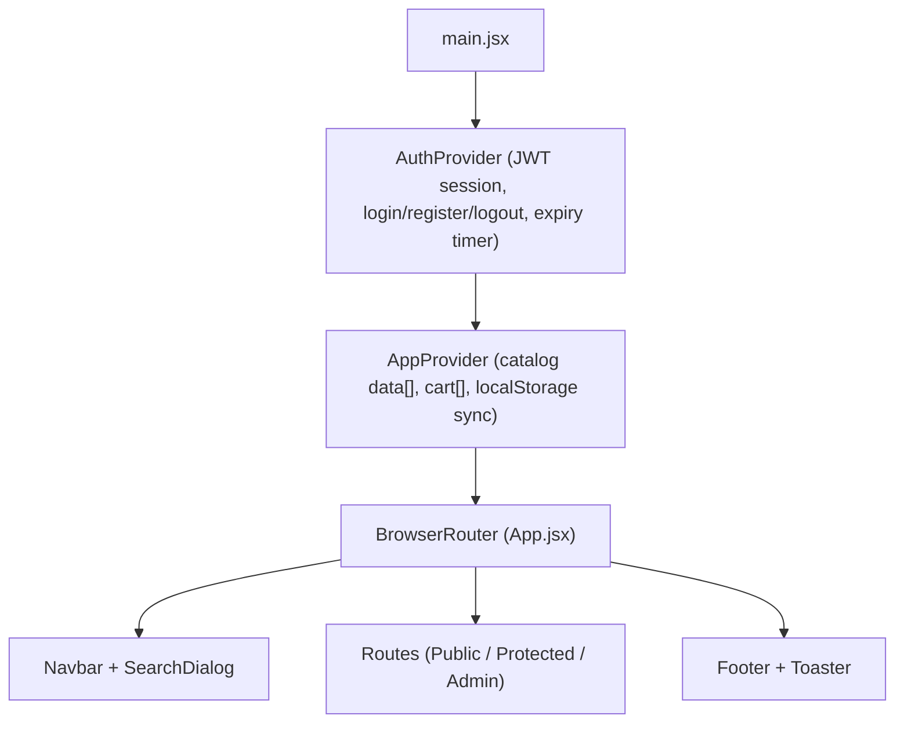

# Frontend Design & Architecture (`e-com-Frontend`)

## 1. Overview & Tech Stack

The frontend is a **React 18** single-page application (SPA) built with **Vite 5** and **Tailwind CSS 4**, featuring a custom token-driven design system, light/dark themes, accessible dialogs/forms, JWT authentication, and AI-assisted shopping and catalog workflows.

| Layer | Technology |
|---|---|
| Framework | React `18.2.0`, React Router `6.22.3` |
| Build & Dev | Vite `5.2.8` (`@vitejs/plugin-react-swc`) |
| Styling | Tailwind CSS `4.3.5` (`@tailwindcss/vite`), `@fontsource-variable/geist` (self-hosted) |
| Icons | `@phosphor-icons/react` `2.1.10` |
| HTTP Client | Axios `1.6.8` + native `fetch` (for `AskAI.jsx`) |
| Quality & CI | ESLint `8.57.0` (`--max-warnings 0`), custom AST/regex design checker (`scripts/check-design.mjs`) |
| Containerization | Multi-stage `Dockerfile` (Node 20 build with `VITE_BASE_URL` -> `nginx:1.27-alpine` with SPA fallback) |

---

## 2. Folder & File Inventory

```text
e-com-Frontend/
├── Dockerfile                          # Node 20 build -> nginx:1.27-alpine
├── nginx.conf                          # SPA fallback: try_files $uri /index.html
├── index.html                          # Metadata, OG tags, pre-paint dark-theme script
├── package.json                        # Scripts: dev, build, lint, preview, check:design
├── vite.config.js                      # React SWC + Tailwind CSS v4 Vite plugins
├── .eslintrc.cjs                       # ESLint config
├── public/
│   ├── favicon.svg                     # Brand icon
│   └── og-image.png                    # Open Graph preview image
├── scripts/
│   └── check-design.mjs                # CI design-system & copy linter (espree AST + regex)
└── src/
    ├── main.jsx                        # Mounts AuthProvider -> AppProvider -> App
    ├── App.jsx                         # BrowserRouter, skip link, routes, Navbar, Footer, Toaster
    ├── axios.jsx                       # Preconfigured Axios instance (baseURL + attachAuth)
    ├── index.css                       # Tailwind v4 @theme tokens, light/dark vars, typography, motion
    ├── auth/
    │   ├── attachAuth.js               # Request Bearer injector + 401 auth:expired event dispatcher
    │   └── jwt.js                      # localStorage session helpers + base64url JWT payload decoder
    ├── config/
    │   └── brand.js                    # Single source of truth for store name, tagline, description
    ├── Context/
    │   ├── AuthContext.jsx             # Auth state, login/register/logout, auto-expiry timer
    │   └── Context.jsx                 # Product catalog cache + persistent localStorage cart
    ├── hooks/
    │   ├── useDocumentTitle.js         # Sets "<Title> | Lumora"
    │   └── useTheme.js                 # Light/dark theme state synced to <html class="dark"> & localStorage
    ├── lib/
    │   └── format.js                   # formatINR, formatDate, toImageSrc (base64/URL), apiError
    ├── ui/                             # Reusable Design System Primitives
    │   ├── Alert.jsx                   # Inline status banners (error, warning, info, success)
    │   ├── BrandMark.jsx               # SVG logo mark
    │   ├── Button.jsx                  # Polymorphic button (variants, sizes, icon mode)
    │   ├── ConfirmDialog.jsx           # Accessible confirmation modal
    │   ├── Dialog.jsx                  # Modal with focus trap, Escape/backdrop close, scroll lock
    │   ├── EmptyState.jsx              # Composed empty state with icon & action slot
    │   ├── Field.jsx                   # Field wrapper + Input, Select, Textarea with aria-invalid
    │   ├── ProductImage.jsx            # Renders base64/URL image or fallback icon
    │   ├── Reveal.jsx                  # IntersectionObserver scroll-reveal wrapper
    │   ├── Skeleton.jsx                # Loading skeletons + ProductCardSkeleton
    │   ├── StatusLabel.jsx             # Order status badge (icon + label, never color-only)
    │   ├── toast.jsx                   # Event-driven toast notification system + Toaster
    │   └── WordReveal.jsx              # Word-by-word scroll reveal for landing tagline
    └── components/                     # Pages & Feature Components
        ├── AddProduct.jsx              # Wrapper for <ProductEditor mode="create" />
        ├── AskAI.jsx                   # RAG support chatbot UI
        ├── AuthPage.jsx                # Shared login/register form
        ├── Cart.jsx                    # Cart management, stock-limit checks, checkout trigger
        ├── CheckoutPopup.jsx           # Order confirmation modal -> POST /api/orders/place
        ├── Footer.jsx                  # Site footer + legal links
        ├── Home.jsx                    # Public landing page (no products)
        ├── Shop.jsx                    # Shopping page (login required) -> Catalog
        ├── Legal.jsx                   # Privacy & Terms pages
        ├── Navbar.jsx                  # Floating glass navbar, search trigger, theme toggle, mobile drawer
        ├── NotFound.jsx                # 404 fallback page
        ├── Order.jsx                   # User/Admin order list, expand items, cancel, advance status
        ├── Product.jsx                 # Product detail page + admin edit/delete actions
        ├── ProductCard.jsx             # Catalog/search grid card
        ├── ProductEditor.jsx           # Create/Edit product form + AI draft/description/image tools
        ├── ProtectedRoute.jsx          # Route guard for authenticated & adminOnly routes
        ├── SearchDialog.jsx            # Smart search modal -> navigates to /search-results?q=...
        ├── SearchResults.jsx           # Calls GET /api/products/smart-search and renders grid
        ├── UpdateProduct.jsx           # Wrapper for <ProductEditor mode="edit" productId={id} />
        └── home/
            ├── Hero.jsx                # Landing hero with live product/category counts
            ├── Catalog.jsx             # Category filterable product grid
            └── Sections.jsx            # ProblemSolution, Benefits, Tagline, HowItWorks, Faq, FinalCta
```

---

## 3. Architecture & State Management

### 3.1 Provider Hierarchy (`main.jsx` & `App.jsx`)



### 3.2 Authentication & Axios Interceptors (`src/auth/`, `AuthContext.jsx`)
- **Interceptor Attachment**: `attachAuth(axios)` is applied both to the default `axios` import (in `AuthContext.jsx`) and the custom `API` instance (in `src/axios.jsx`).
- **Scoped Bearer Injection**: The request interceptor attaches `Authorization: Bearer <token>` **only** when the resolved target URL starts with `API_BASE` (`VITE_BASE_URL || "http://localhost:8080"`), preventing token leakage to third-party origins.
- **Session Expiry Handling**:
  1. On startup, `AuthProvider` checks `isTokenExpired(saved.token)` (with 5s skew) before restoring state.
  2. A `setTimeout` schedules `auth:expired` at the token's `exp` claim.
  3. Any `401` response on a request that sent an `Authorization` header dispatches `window.dispatchEvent(new Event("auth:expired"))`, logging the user out and showing a toast.
- **Note on `AskAI.jsx`**: Uses native `fetch` instead of Axios, so it explicitly attaches `Authorization: Bearer ${getToken()}`.

### 3.3 Routing & Access Control (`App.jsx`, `ProtectedRoute.jsx`)

| Route | Component | Access |
|---|---|---|
| `/` | `Home` | Public (landing page, no products) |
| `/shop` | `Shop` | Authenticated (`USER` or `ADMIN`) |
| `/admin` | `AdminDashboard` | `ADMIN` only |
| `/login`, `/register` | `AuthPage` | Public |
| `/product/:id` | `Product` | Authenticated |
| `/cart` | `Cart` | Authenticated (customers; admins cannot check out) |
| `/search-results` | `SearchResults` | Authenticated |
| `/privacy`, `/terms` | `Legal` | Public |
| `/orders` | `Order` | Authenticated (`USER` or `ADMIN`) |
| `/askai` | `AskAi` | Authenticated |
| `/add_product` | `AddProduct` | `ADMIN` only |
| `/product/update/:id` | `UpdateProduct` | `ADMIN` only |
| `*` | `NotFound` | Public |

---

## 4. Design System & Enforcement

### 4.1 Tokens & Theme (`src/index.css`, `index.html`)
- **Typography**: Self-hosted `Geist Variable` only (`--font-sans`). All text uses semantic component classes:
  - `.heading-1` to `.heading-6`
  - `.title-1` to `.title-5`
  - `.body-1` to `.body-6`
  - `.button-lg`, `.button-md`, `.button-sm`, `.button-xsm`
  - `.caption-1` to `.caption-5`
- **Color Tokens**: Semantic CSS variables (`--page`, `--surface`, `--raised`, `--hover`, `--strong`, `--sunken`, `--fg`, `--muted`, `--subtle`, `--line`, `--success`, `--warning`, `--danger`, `--info`) switched via `<html class="dark">`. An inline script in `index.html` applies the saved/system theme before first paint to prevent FOUC.
- **Motion & Accessibility**:
  - Single easing curve: `--ease-brand: cubic-bezier(0.22, 1, 0.36, 1)`.
  - Scroll reveals (`.reveal`) animate only `opacity` and `transform` via `IntersectionObserver`.
  - `@media (prefers-reduced-motion: reduce)` disables transforms/pulses in favor of plain opacity fades.
  - Skip-to-content link, `focus-visible` outlines, focus-trapped `Dialog`, and non-color-only `StatusLabel`.

### 4.2 Automated Design Rule Checker (`scripts/check-design.mjs`)
Runs in CI via `npm run check:design` and fails the build on violations:
1. **Spacing Scale**: Margin, padding, `gap`, and `space-*` classes must use `{0, 0.5, 1, 2, 3, 4, 6, 8, 10, 12, 16, 20, 24}`.
2. **No Arbitrary Values**: Brackets `[...]` in utility classes are forbidden except `max-w-[680px]` and `transition-[...]`.
3. **Named Text Styles Only**: Direct `text-xs..9xl` or `font-medium/semibold/bold/...` in JSX are rejected.
4. **Forbidden Styles & Libraries**: No `italic`, Tailwind gradient utilities (`bg-gradient-*`, `from-*`), unapproved fonts (`Inter`, `Roboto`, etc.), external `https://` links (except `localhost` / `w3.org`), `console.*`, `alert`/`confirm`, or competing icon/UI libraries (`react-icons`, `bootstrap`, `@mui`, `react-toastify`, etc.).
5. **AST Copy Rules (`espree`)**: JSX text, copy attributes, and `toast(...)` messages must not contain word-joining hyphens (`A-B`), em/en dashes (`—`/`–`), exclamation marks (`!`), or banned marketing filler words (`supercharge`, `cutting-edge`, `effortless`, `world-class`, etc.).
