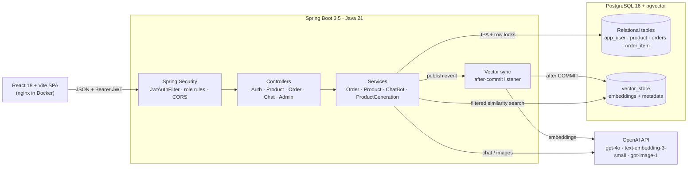
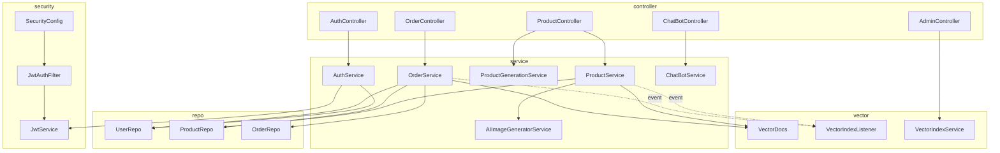
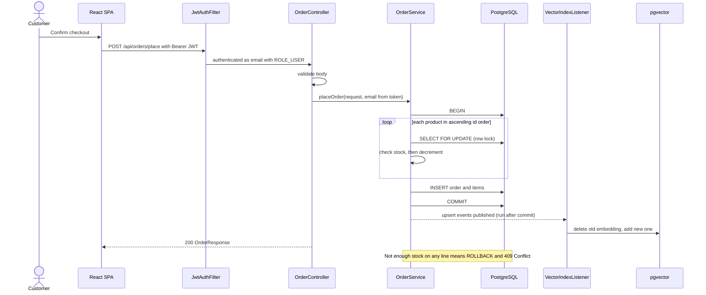
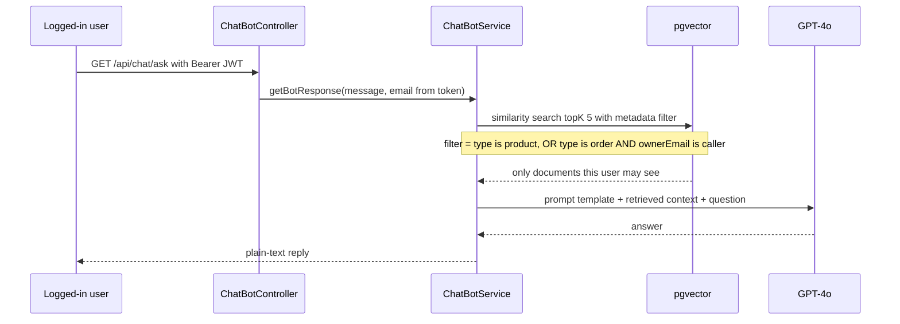
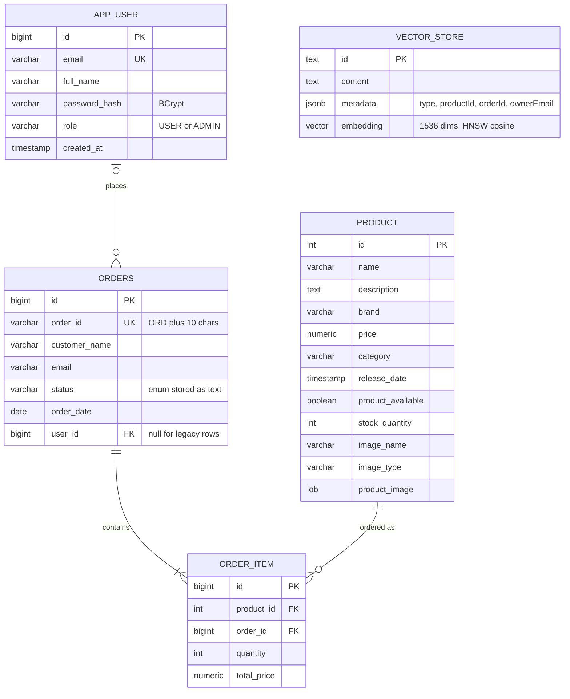

# AI-Powered E-Commerce Platform

A full-stack e-commerce application (Spring Boot + React) with **JWT security**, **concurrency-safe ordering**, and a **RAG layer** (Spring AI + pgvector) that powers semantic product search, a customer-support chatbot, and AI-assisted product creation.

## Highlights

- **Concurrency-safe checkout**: orders run in one transaction with pessimistic row locks (`SELECT … FOR UPDATE`) taken in a fixed order, so two buyers can't oversell the last unit and can't deadlock each other.
- **Tenant-safe RAG**: the chatbot's vector query is filtered *before* the LLM sees anything (`type = product OR (type = order AND ownerEmail = caller)`), so one customer can never retrieve another's orders.
- **Eventually-consistent vector index**: embeddings are updated by an after-commit event listener, so a rolled-back order never reaches the index and no DB transaction stays open during slow OpenAI calls.
- **Stateless auth**: Spring Security + JWT (HS256), BCrypt password hashing, `USER` / `ADMIN` roles, centralised CORS allow-list.
- **Order lifecycle**: `PLACED → CONFIRMED → SHIPPED → DELIVERED`, with cancellation (stock restored) before shipping. Illegal jumps are rejected by a small state machine.
- **A designed, accessible interface**: a Tailwind design system (self hosted Geist font, Phosphor icons, named text styles, spacing and radius tokens), light and dark themes, a floating glass navigation, scroll reveals that respect reduced motion, skeleton loading, accessible dialogs, and a design rule checker that runs in CI.
- **Production hygiene**: bean validation, uniform JSON errors, OpenAPI/Swagger docs, Dockerfiles, one-command `docker compose`, CI workflow, Testcontainers integration tests.

## Features

| Area | What it does |
|---|---|
| Storefront | Browse products, product detail, cart, checkout (login required to order) |
| Accounts | Register / login, role-based UI and API access |
| Orders | Place order, "My Orders", cancel, admin status updates and a full order view |
| AI semantic search | Natural-language product search: vector retrieval, then LLM re-ranking, then real entities loaded from the DB |
| AI support chatbot | RAG over products and the caller's own orders |
| AI product creation (admin) | Generate a description, an image, or a whole product draft from one sentence; the form is pre-filled for review, nothing is saved automatically |
| Admin | Catalog CRUD, order management, vector re-index |

## Architecture

### High-level system



### Backend components



### Placing an order (end to end)



### RAG support chatbot (data isolation)



### Database (ERD)



`vector_store` has no foreign keys: it is a derived index rebuilt from the relational tables (see *Re-index* below).

## Admin and customer roles

| | Customer (`USER`) | Admin (`ADMIN`) |
|---|---|---|
| Browse the shop and search products (login required) | Yes | Yes, with Edit instead of Add to cart |
| Ask AI chatbot | Yes | No |
| Place, follow and cancel own orders | Yes | No (admins manage the store, `POST /api/orders/place` is customers only) |
| Dashboard, stock, all orders, customers, notifications, admin AI | No | Yes (`/admin`, API under `/api/admin/**`) |

Registration always creates a customer. The first admin is created at startup from `ADMIN_EMAIL` and `ADMIN_PASSWORD`.

### Admin dashboard (`/admin`)
- **Overview**: orders, customers, units ordered, payments received and pending, best sellers, low stock and alerts computed from the data.
- **Products and stock**: products grouped by category with photo, units sold and an editable stock count. "Add product" opens the existing editor with the category preselected. Whatever the admin uploads is what customers see in the shop.
- **Orders**: every order with customer contact, delivery address, payment, courier and tracking number. Confirm, ship (with courier and tracking), deliver, cancel, mark paid.
- **Customers**: name, email, joined date, orders and total spent.
- **Notifications**: one entry for every product line of every new order, plus low stock, out of stock and cancellations (bell in the navbar, checked every 30 seconds). Stock at or below `app.stock.low-threshold` (default 5) raises an alert.
- **AI assistant**: ask about products, orders, stock and payments. Figures come from SQL aggregates, the model only explains them. Customer names, emails, phones and addresses are not sent to the AI provider.

### Payments
Checkout records the method (cash, UPI or card **on delivery**) and a payment status (`PENDING`, `PAID`, `FAILED`, `REFUNDED`). Delivering an order settles a pending payment, and cancelling a paid order marks it refunded. No money is processed by this app: connect a gateway (for example Razorpay) before taking online payments.

### Configuration
Copy `.env.example` to `.env` in the project root (next to `docker-compose.yml`). The backend imports this file when its working directory is `SpringEcomAI` (the `../.env` path) or when a `.env` is placed directly in that working directory. Paths in `spring.config.import` are relative to the process working directory, not the location of `application.properties`; in IntelliJ, set the Spring Boot run configuration's **Working directory** to the `SpringEcomAI` folder. Alternatively, set `SPRING_DATASOURCE_PASSWORD` (or `DB_PASSWORD`) in the run configuration's environment variables. Never put secrets in `application.properties`.

## Key engineering decisions

| Decision | Why |
|---|---|
| Pessimistic locking, fixed lock order | Stock is a hot, contended counter. `SELECT … FOR UPDATE` serialises buyers of the same product; locking rows in ascending id order makes deadlocks impossible between multi-item orders. |
| `@Transactional` order placement | All lines are reserved or none are. A failing line rolls back earlier decrements (covered by an integration test). |
| Vector updates via after-commit events | The relational DB is the source of truth. The index is updated only for committed data and never inside a DB transaction. If OpenAI is down, the order still succeeds and the index can be repaired with `POST /api/admin/reindex`. |
| Metadata-filtered retrieval | Authorisation belongs in the data layer. Filtering the vector query means private data never enters the prompt, which defeats prompt-injection attempts to extract it. |
| PII minimisation in embeddings | Customer name and email are stored as metadata (not embedded), so they are never sent to the embedding API. |
| JWT + stateless sessions | Fits a decoupled SPA + REST API and scales horizontally with no session store. Role is a signed claim; tampering invalidates the signature. |
| Uniform login error | "Invalid email or password" for both unknown email and wrong password prevents account enumeration. |
| Roles never come from the client | Registration always creates `USER`; the first `ADMIN` is seeded from environment variables (no mass-assignment escalation). |
| Ownership-scoped queries | A customer asking for someone else's order gets `404`, not `403`, so order IDs can't be probed. |
| Structured LLM output + normalizer | The AI product draft is deserialised into a record and then clamped to valid values (allowed category, ISO date, non-negative numbers). LLM output is treated as untrusted input. |

## Frontend design system

The interface follows a small, strict set of rules so every screen feels consistent:

- **Typography:** one typeface (Geist, bundled locally). Every piece of text uses a named style (`heading-1` to `heading-6`, `title-1` to `title-5`, `body-1` to `body-6`, `button-lg` to `button-xsm`, `caption-1` to `caption-5`) built only from Tailwind's default type scale.
- **Tokens:** spacing, corner radius and dark theme backgrounds come from fixed sets. Nested shapes use the radius formula (inner radius = outer radius minus the gap).
- **Motion:** one decelerating curve for everything, only `transform` and `opacity` are animated, scroll reveals use `IntersectionObserver` (no scroll listeners), and `prefers-reduced-motion` swaps movement for a plain fade.
- **States:** every control has hover, active and visible focus states. Lists show skeletons while loading, composed empty states, and inline errors. There are no browser `alert` or `confirm` popups.
- **Accessibility:** skip link, semantic landmarks, labelled form fields with inline errors, focus trapped and restored in dialogs, current page marked in the navigation, status never shown by color alone.
- **Landing page:** hero, catalog, problem and solution, benefits, how it works, a word by word tagline reveal, FAQ, and a closing call to action.

`npm run check:design` enforces the mechanical parts (spacing scale, arbitrary values, fonts, icon libraries, hyphens and filler words in copy, leftover `console` output). `npm run lint` runs ESLint. Both run in CI.

To rename the store, change `name` in `e-com-Frontend/src/config/brand.js` (and the title and Open Graph tags in `index.html`).

## Tech stack

**Backend:** Java 21, Spring Boot 3.5, Spring Web, Spring Data JPA (Hibernate), Spring Security, JJWT, Bean Validation, Spring AI 1.0 (OpenAI chat / embeddings / images, pgvector store), springdoc-openapi, Lombok
**Frontend:** React 18, Vite, Tailwind CSS 4, React Router, Axios, Phosphor icons, Geist (self hosted). Nothing is loaded from a CDN.
**Data:** PostgreSQL 16 with the pgvector extension (HNSW index, cosine distance)
**DevOps / quality:** Docker, Docker Compose, GitHub Actions, JUnit 5, Mockito, Testcontainers

## API reference

Interactive docs: `http://localhost:8080/swagger-ui.html` (use **Authorize** and paste the token from `/api/auth/login`).

| Method | Path | Access |
|---|---|---|
| POST | `/api/auth/register` | public |
| POST | `/api/auth/login` | public |
| GET | `/api/products`, `/api/product/{id}`, `/api/product/{id}/image` | public |
| GET | `/api/products/smart-search?query=` | public |
| POST | `/api/product` (multipart), `PUT /api/product/{id}`, `DELETE /api/product/{id}` | ADMIN |
| POST | `/api/product/generate-description`, `/generate-image`, `/generate-product` | ADMIN |
| POST | `/api/orders/place` | logged in |
| GET | `/api/orders` | USER: own orders, ADMIN: all |
| POST | `/api/orders/{orderId}/cancel` | order owner or ADMIN |
| PATCH | `/api/orders/{orderId}/status` | ADMIN |
| GET | `/api/chat/ask?message=` | logged in |
| POST | `/api/admin/reindex` | ADMIN |

Errors are JSON: `{"error": "...", "message": "..."}`; validation errors add a `fields` map.

## Getting started

### Option A: everything in Docker

```bash
cp .env.example .env        # fill in OPENAI_API_KEY, JWT_SECRET, POSTGRES_PASSWORD, ADMIN_*
docker compose up --build
```

UI `http://localhost:3000` · API `http://localhost:8080` · Swagger `http://localhost:8080/swagger-ui.html`

### Option B: local development

#### Windows (PowerShell)

Prerequisites: Java 21, Node.js/npm, and PostgreSQL with the `pgvector` extension installed. Docker is not required for this setup. Make sure PostgreSQL is running and create the `ecommerce` database if it does not already exist. Connect to it and enable pgvector:

```sql
CREATE EXTENSION IF NOT EXISTS vector;
```

Open two PowerShell windows from the project directory.

**1. Start the backend** (first window):

```powershell
cd C:\path\to\ai-powered-ecommerce-app-main\SpringEcomAI
$env:SPRING_DATASOURCE_URL = "jdbc:postgresql://localhost:5432/ecommerce"
$env:SPRING_DATASOURCE_USERNAME = "postgres"
$env:SPRING_DATASOURCE_PASSWORD = "<your PostgreSQL password>"
$env:SERVER_PORT = "8081"
# Optional: required for AI chat, semantic search, and AI product generation.
$env:OPENAI_API_KEY = "<your OpenAI API key>"
.\mvnw.cmd spring-boot:run
```

Replace the example path and database credentials with your local values. The backend creates/updates application tables on startup. Its API and Swagger UI are available at `http://localhost:8081` and `http://localhost:8081/swagger-ui.html`.

If running from IntelliJ, set the Spring Boot run configuration's **Working directory** to the `SpringEcomAI` folder. This is required for the root `.env` import (`../.env`) to resolve; otherwise set `SPRING_DATASOURCE_PASSWORD` in the run configuration's environment variables.

**2. Start the frontend** (second window):

```powershell
cd C:\path\to\ai-powered-ecommerce-app-main\e-com-Frontend
npm ci
$env:VITE_BASE_URL = "http://localhost:8081"
npm run dev
```

Open `http://localhost:5173`. Keep both terminal windows open while using the app; press `Ctrl+C` in each to stop its server. The frontend’s API URL is set for the current PowerShell session, so set it again whenever you restart the frontend.

If PostgreSQL reports that the `vector` extension is unavailable, install a pgvector build compatible with your PostgreSQL version before starting the backend. If startup reports `The server requested SCRAM-based authentication, but no password was provided`, Spring did not load a password: check the IDE working directory and set `SPRING_DATASOURCE_PASSWORD` if needed. If startup reports `Unable to determine Dialect without JDBC metadata`, Hibernate could not connect to PostgreSQL to read its metadata; the message is not, by itself, evidence that a dialect setting is missing. Check that PostgreSQL is running and that the URL, database, username, and password are correct. Verify the server is listening with `Test-NetConnection localhost -Port 5432`; use `DB_URL` and `DB_USERNAME` to override the local defaults, or use the standard `SPRING_DATASOURCE_URL`, `SPRING_DATASOURCE_USERNAME`, and `SPRING_DATASOURCE_PASSWORD` environment variables. When using `.env`, `POSTGRES_DB`, `POSTGRES_USER`, and `POSTGRES_PASSWORD` are also used by the local backend.

#### macOS/Linux

```bash
# 1. Start PostgreSQL with pgvector before starting the backend (the app does not auto-start Docker Compose).
export OPENAI_API_KEY=sk-...
export JWT_SECRET=$(openssl rand -base64 32)      # optional in dev: an ephemeral key is used if unset
export ADMIN_EMAIL=admin@example.com ADMIN_PASSWORD=change-me-too
cd SpringEcomAI && ./mvnw spring-boot:run

# 2. frontend
cd e-com-Frontend && cp .env.example .env && npm install && npm run dev      # http://localhost:5173
```

### Configuration

| Variable | Purpose |
|---|---|
| `OPENAI_API_KEY` | Chat, embeddings and image generation |
| `JWT_SECRET` | Base64 key, at least 32 bytes. If unset, an ephemeral key is generated (tokens die on restart) |
| `ADMIN_EMAIL`, `ADMIN_PASSWORD` | Seed the first ADMIN account at startup (skipped if either is empty) |
| `POSTGRES_DB`, `POSTGRES_USER`, `POSTGRES_PASSWORD` | Database name, user and password (Docker and local `.env`) |
| `DB_URL`, `DB_USERNAME`, `DB_PASSWORD` | Optional local backend connection overrides |
| `app.cors.allowed-origins` | Allowed frontend origins (default `http://localhost:5173`) |

### Re-index (after upgrading from the old vector schema)

Older vector documents lacked the `type` / `ownerEmail` metadata, so the filtered queries won't see them. Log in as an admin and run once:

```bash
curl -X POST http://localhost:8080/api/admin/reindex -H "Authorization: Bearer <admin token>"
```

This rebuilds the whole index from the database and also repairs any drift.

## Testing

```bash
cd SpringEcomAI && ./mvnw verify
```

| Test class | Kind | Covers |
|---|---|---|
| `OrderServiceIntegrationTest` | Integration (Testcontainers, real PostgreSQL) | Two concurrent buyers of the last unit: exactly one succeeds. A failed multi-line order rolls back. Cancel restores stock once. Per-user order visibility. |
| `SpringEcomAiApplicationTests` | Integration | Application context boots against PostgreSQL + pgvector |
| `SecurityRulesTest` | Web layer (MockMvc) | Who can call what (401 / 403 / 200), tampered and forged tokens, CORS, validation and error mapping |
| `OrderServiceTest` | Unit | Stock reservation, duplicate-line merging, lock ordering, cancel rules, status transitions |
| `ChatBotServiceTest` | Unit | The vector filter contains only products and the caller's own orders |
| `JwtServiceTest`, `AuthServiceTest` | Unit | Token signing, expiry and tampering; hashing; duplicate email; uniform login error |
| `VectorIndexListenerTest`, `ProductGenerationServiceTest`, `ProductDraftNormalizerTest`, `OrderStatusTest` | Unit | After-commit sync, AI draft validation, order state machine |

The integration tests are skipped automatically when Docker isn't available. The frontend build runs in CI (`npm run build`).

## Project structure

```
.
├── SpringEcomAI/                 Spring Boot API
│   └── src/main/java/com/lumora/shop/
│       ├── controller/           REST endpoints
│       ├── service/              business logic (orders, products, chatbot, auth, AI generation)
│       ├── repo/                 Spring Data JPA repositories
│       ├── model/ (+ dto/)       entities, enums, request/response records
│       ├── security/             JWT service, filter, security configuration
│       ├── vector/               vector documents, after-commit sync, re-index
│       ├── exception/            custom exceptions + global handler
│       └── config/               ChatClient, VectorStore, OpenAPI, admin seeding
├── e-com-Frontend/               React SPA (Vite + Tailwind)
│   ├── src/ui/                   design system primitives (Button, Field, Dialog, toast, Reveal ...)
│   ├── src/components/           pages, plus home/ sections for the landing page
│   ├── src/config/brand.js       the store name, in one place
│   └── scripts/check-design.mjs  design rule checker (runs in CI)
├── docker-compose.yml            full stack (db + api + ui)
└── .github/workflows/ci.yml      build + test
```

## Known limitations and next roadmap of planning 

Being explicit about the trade-offs:

- **Token handling:** the JWT lives in `localStorage` (simple, but readable by injected scripts); there are no refresh tokens, no server-side revocation, and no login rate limiting. A role change takes effect at the next login. Next steps: short-lived access token + httpOnly refresh cookie, login throttling.
- **Product images are stored in the database** (`@Lob`). Fine at this scale; object storage (S3/MinIO) plus lazy loading would be the next step.
- **No pagination** on product and order lists; **semantic search costs an LLM call per query** and the public search endpoint has no rate limit.
- **Eventual consistency of the index:** right after a commit there is a short window in which search results lag the database; failures are logged and repairable with `/api/admin/reindex`.
- **Frontend quality:** ESLint and the design rule check run in CI, but there are no automated component or end to end tests yet.
- **Payments, email notifications and refunds** are out of scope.
